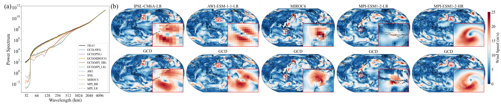
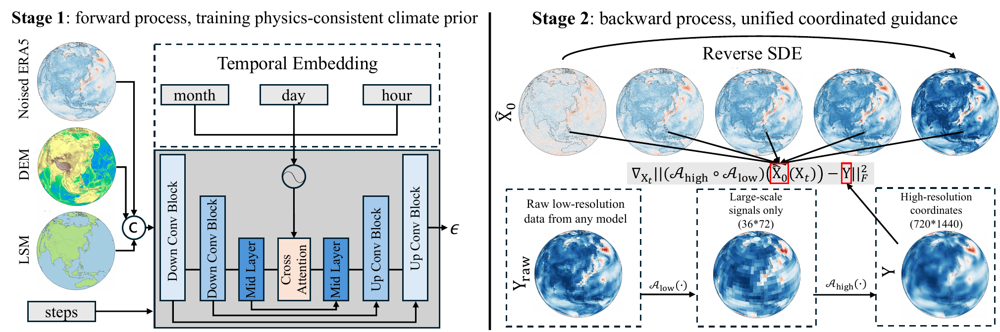

# GCD: GCM-consistent Diffusion for Zero-shot Downscaling across Heterogeneous GCMs (NeurIPS 2026)

<p align="center">
  <a href="assets/main-result_TC_vis.pdf">
    
  </a>
</p>

[Chinese README](README_CN.md)

## Overview

Climate downscaling across heterogeneous General Circulation Models (GCMs) is an ill-posed inverse problem: coarse GCM outputs and high-resolution reanalysis fields arise from different dynamical systems and lack fine-scale temporal pairing. **GCD** performs zero-shot downscaling by combining a high-resolution climate diffusion prior with coarse GCM constraints, without model-specific retraining.

GCD integrates geographic conditioning, spectrally filtered measurement guidance, and distillation-accelerated Conjugate Gradient (CG) guidance. It reduces inference from 1,000 diffusion steps to 6 while preserving input-GCM consistency. Across five heterogeneous GCMs, GCD improves extreme-event fidelity and recovers high-frequency tropical-cyclone structures.

<p align="center">
  <a href="assets/flowchart.pdf">
    
  </a>
</p>

## Installation

Python 3.8+, a CUDA GPU, and a CUDA-compatible PyTorch build are required.

```bash
pip install -r requirements.txt
```

## Configuration

- `configs/model_config_5var.yaml`: UNet architecture configuration (five variables as an example).
- `configs/prior_training_config.yaml`: ERA5 diffusion-prior training configuration.
- `configs/distillation_config_4to1.yaml`: 4-to-1 distillation training configuration.
- `configs/5var_miroc6_coarsen_nearest_cg.yaml`: downscaling inference task configuration (MIROC6 as an example).
- `configs/diffusion_config.yaml`: diffusion-process configuration.


## Data

Data and model weights are not included. Obtain the ERA5 data for prior training and the GCM data for distillation or inference, then set the paths under `data` in `configs/prior_training_config.yaml`, `configs/distillation_config_4to1.yaml`, and `configs/5var_miroc6_coarsen_nearest_cg.yaml`.

The ERA5 and GCMs Zarr store should provide the `z` field with `time`, `level`, and two spatial dimensions; the five channels used in paper are `z250`, `z500`, `u10`, `v10`, and `msl`.


## Model weights

Distillation requires a pretrained teacher model: the diffusion-prior model trained on ERA5. It can be obtained by running the command in the following section.

Teacher and student model weights are also available directly from [Hugging Face](https://huggingface.co/shawnvonbohr/GCD-Climate-Downscaling). After downloading, preserve the following local layout:

```text
checkpoints/
├── teacher/
│   └── teacher_checkpoint.pt
└── progressive_4to1/
    └── student_round0_final.pt
```

## Prior training

Train the ERA5 diffusion prior used as the teacher model:

```bash
python script/train_prior.py \
  --config configs/prior_training_config.yaml \
  --gpus 1
```

`--gpus 1` uses one GPU. The trainer uses DDP for multiple GPUs, for example, to use four GPUs: `--gpus 4`.


The final teacher checkpoint is saved to `checkpoints/teacher/teacher_checkpoint.pt` and can be used directly for distillation.


## Distillation training

Run 4-to-1 distillation: DDIM-25 teacher → DDIM-6 student.

```bash
python script/train_progressive_distillation.py \
  --config configs/distillation_config_4to1.yaml \
  --gpus 1
```

The final student checkpoint can be used  for fast downscaling inference.


## Downscaling inference

The command below uses MIROC6 as an example. Other GCM data can also be used for zero-shot downscaling.

```bash
python script/distilled_dps_inference_ddp.py \
  --model_config configs/model_config_5var.yaml \
  --diffusion_config configs/diffusion_config.yaml \
  --task_config configs/5var_miroc6_coarsen_nearest_cg.yaml \
  --distilled_ckpt checkpoints/progressive_4to1/student_round0_final.pt
```

## Citation

This work has been accepted at NeurIPS 2026. Publication links will be added when available.

```bibtex
@misc{gcd2026,
  title={GCD: GCM-consistent Diffusion for Zero-shot Downscaling across Heterogeneous GCMs},
  author={Ruian Tie, Wenbo Xiong, Zhengyu Shi, Xinyu Su, Chenyu jiang, Libo Wu, Hao Li},
  year={2026},
  eprint={2601.21760},
  archivePrefix={arXiv},
  url={https://arxiv.org/abs/2601.21760}
}
```
