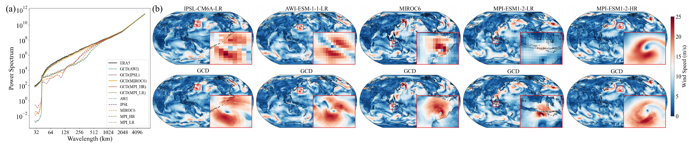
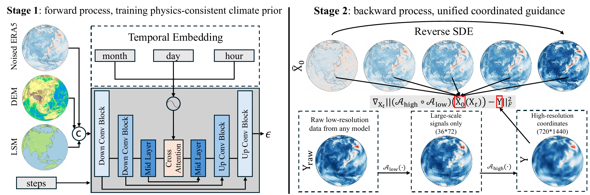

# GCD：面向异质 GCM 零样本降尺度的 GCM 一致性扩散模型 (NeurIPS 2026)

<p align="center">
  <a href="assets/main-result_TC_vis.pdf">
    
  </a>
</p>

[English README](README.md)

## 简介

异质的通用环流模型（GCM）的气候降尺度是一个病态逆问题：粗分辨率 GCM 输出与高分辨率再分析场来自不同的动力系统，且缺少细尺度时间配对数据。**GCD** 在无需针对特定 GCM 重新训练的前提下，将高分辨率气候扩散先验与粗分辨率 GCM 约束结合，实现零样本降尺度。

GCD 融合地理条件、频谱滤波测量引导和蒸馏加速的共轭梯度（CG）引导，在保持输入 GCM 一致性的同时，将推理步数从 1,000 步降低到 6 步。在五个异质 GCM 上，GCD 提升了极端事件的刻画能力，并恢复了热带气旋的高频结构。

<p align="center">
  <a href="assets/flowchart.pdf">
    
  </a>
</p>

## 安装

需要 Python 3.8+、CUDA GPU 和匹配 CUDA 的 PyTorch：

```bash
pip install -r requirements.txt
```

## 配置

- `configs/model_config_5var.yaml`：UNet 模型结构配置（以 5 个变量为例）。
- `configs/prior_training_config.yaml`：ERA5 扩散先验训练配置。
- `configs/distillation_config_4to1.yaml`：4→1 蒸馏训练配置。
- `configs/5var_miroc6_coarsen_nearest_cg.yaml`：降尺度推理任务配置（以 MIROC6 为例）。
- `configs/diffusion_config.yaml`：扩散过程配置。


## 数据

仓库不包含数据与模型权重。请自行获取用于先验训练的 ERA5 数据，以及用于蒸馏或推理的 GCM 数据；随后在 `configs/prior_training_config.yaml`、`configs/distillation_config_4to1.yaml` 和 `configs/5var_miroc6_coarsen_nearest_cg.yaml` 的 `data` 部分填写路径。

## 模型权重

蒸馏训练需要预训练的 teacher 模型权重，即使用 ERA5 训练的扩散先验模型。可用下面小节的命令训练获得。

teacher模型权重和student模型权重也可直接从 [Hugging Face](https://huggingface.co/shawnvonbohr/GCD-Climate-Downscaling) 下载。下载后请保持以下本地目录结构：

```text
checkpoints/
├── teacher/
│   └── teacher_checkpoint.pt
└── progressive_4to1/
    └── student_round0_final.pt
```

## 先验训练

训练作为 teacher 模型的 ERA5 扩散先验：

```bash
python script/train_prior.py \
  --config configs/prior_training_config.yaml \
  --gpus 1
```

`--gpus 1` 表示使用 1 张 GPU。多卡训练采用 DDP，例如使用 4 张 GPU：

```bash
CUDA_VISIBLE_DEVICES=0,1,2,3 python script/train_prior.py \
  --config configs/prior_training_config.yaml \
  --gpus 4
```


## 蒸馏训练

进行 4→1 蒸馏：DDIM-25 teacher → DDIM-6 student。

```bash
python script/train_progressive_distillation.py \
  --config configs/distillation_config_4to1.yaml \
  --gpus 1
```


## 降尺度推理

下方命令以 MIROC6 为例。其他 GCM 数据同样可用于零样本降尺度。

```bash
python script/distilled_dps_inference_ddp.py \
  --model_config configs/model_config_5var.yaml \
  --diffusion_config configs/diffusion_config.yaml \
  --task_config configs/5var_miroc6_coarsen_nearest_cg.yaml \
  --distilled_ckpt checkpoints/progressive_4to1/student_round0_final.pt
```

## 引用

本文已被 NeurIPS 2026 接收。论文链接确认后会补充。

```bibtex
@misc{gcd2026,
  title={GCD: GCM-consistent Diffusion for Zero-shot Downscaling across Heterogeneous GCMs},
  author={Ruian Tie, Wenbo Xiong, Zhengyu Shi, Xinyu Su, Chenyu jiang, Libo Wu, Hao Li},
  year={2026},
  eprint={2601.21760},
  archivePrefix={arXiv},
  url={https://arxiv.org/pdf/2601.21760v3}
}
```
